<div align="center">

<picture>
  <source media="(prefers-color-scheme: dark)" srcset="./dark.svg">
  <source media="(prefers-color-scheme: light)" srcset="./light.svg">
  
</picture>

<br><br>

### Full-Stack Developer · AI Builder · Platform Architect

`⚛️ React / Next.js` &nbsp;·&nbsp; `⚙️ Node.js` &nbsp;·&nbsp; `🟦 TypeScript` &nbsp;·&nbsp; `🍃 MongoDB` &nbsp;·&nbsp; `⚡ Vite` &nbsp;·&nbsp; `🐍 Python` &nbsp;·&nbsp; `☁️ Cloudflare`

<br>

*I build AI-powered products, scalable web platforms, automation workflows, and production systems at Bluelab Technologies.*

<br>

[](https://github.com/ashwiths)
[](https://github.com/ashwiths?tab=repositories)
[](https://www.bluelabtech.space/)

</div>

---

### `// 01. IDENTITY & MISSION`

```bash
$ ashwiths --status
```

> **Full Stack Developer & AI Builder** based in Coimbatore, focused on designing scalable web architectures, AI-powered applications, and developer-centric digital ecosystems.
> 
> Founder & Platform Architect at **Bluelab Technologies**, crafting interconnected software platforms that empower users, optimize workflows, and bring ideas to life.

- ⚡ **Current Focus:** Building scalable web applications, automation tools, and developer platforms
- 🧠 **Exploration:** AI-powered systems, cybersecurity architectures, and modern web tooling
- 🏢 **Organization:** Founder & Builder at **Bluelab Technologies**
- 📍 **Base:** Coimbatore, India
- 🌐 **Portfolio:** [ashil.space](https://www.ashil.space/)

---

### `// 02. ACTIVE ECOSYSTEM & PLATFORMS`

Building cohesive digital ecosystems designed to solve real-world problems through speed, simplicity, and modern design.

#### 🌌 Savee Ecosystem
*A modern digital toolkit engineered for productivity, security, and utility.*

| Platform | Domain | Description | Status |
| :--- | :--- | :--- | :---: |
| **BIBLE** | [bible.savee.space](https://bible.savee.space/) | Interactive scripture and spiritual reflection platform | `LIVE ⚡` |
| **HEAL** | [savee.space](https://www.savee.space/) | Mental wellness, mindfulness, and healing resources | `LIVE ⚡` |
| **DROP** | [drop.savee.space](https://drop.savee.space/) | Seamless, ephemeral file sharing and asset transfer | `LIVE ⚡` |
| **TYPE** | [type.savee.space](https://type.savee.space/) | Minimalist, distraction-free typography and typing experience | `LIVE ⚡` |
| **SAFEFILE** | [safe.savee.space](https://safe.savee.space/) | Secure client-side encrypted cloud storage utility | `LIVE ⚡` |
| **FONTGEN** | [font.savee.space](https://font.savee.space/) | Dynamic font generation and typographic styling tool | `LIVE ⚡` |

<br>

#### 🔷 Bluelab Technologies
*Developer-focused platforms and productivity suites.*

| Platform | Domain | Description | Status |
| :--- | :--- | :--- | :---: |
| **BLUELAB** | [bluelabtech.space](https://www.bluelabtech.space/) | Official central technology hub and ecosystem portal | `ACTIVE 🚀` |
| **SHEETHUB** | [sheethub.bluelabtech.space](https://sheethub.bluelabtech.space/) | Spreadsheet automation and dynamic tabular workflows | `ACTIVE 🚀` |
| **PROJECTHUB** | [projecthub.bluelabtech.space](https://projecthub.bluelabtech.space/) | Collaborative project showcase and repository directory | `ACTIVE 🚀` |
| **DEVKIT** | [dev.bluelabtech.space](https://dev.bluelabtech.space/) | Comprehensive developer utilities and productivity tools | `ACTIVE 🚀` |
| **NETCHECK** | [check.bluelabtech.space](https://check.bluelabtech.space/) | Real-time network diagnostic and edge connectivity testing | `ACTIVE 🚀` |

---

### `// 03. ENGINEERING STACK`

```text
┌── LANGUAGES & RUNTIMES ───► TypeScript · JavaScript · Python · Node.js · HTML5/CSS3
├── FRONTEND ARCHITECTURE ──► React · Next.js · Vite · Responsive UI · Tailwind/Vanilla CSS
├── BACKEND & SYSTEMS ──────► Express · REST APIs · Serverless Architecture · Automation
├── DATABASES & STORAGE ────► MongoDB · Cloud Storage · Edge KV
└── PLATFORMS & DEPLOYMENT ─► Vercel · Cloudflare · Git · GitHub Actions · VS Code
```

<div align="center">


</div>

---

### `// 04. GITHUB ACTIVITY`

<div align="center">


<br>


</div>

<br>

<div align="center">

### 🐍 Contribution Activity

<picture>
  <source media="(prefers-color-scheme: dark)" srcset="./github-contribution-grid-snake-dark.svg">
  <source media="(prefers-color-scheme: light)" srcset="./github-contribution-grid-snake.svg">
  
</picture>

<br>

[](https://github.com/ashwiths)

</div>

---

### `// 05. CONNECT & COLLABORATE`

<div align="center">

<a href="https://www.ashil.space/">
  
</a>
&nbsp;
<a href="https://linkedin.com/in/infant-ashil">
  
</a>
&nbsp;
<a href="https://github.com/ashwiths">
  
</a>
&nbsp;
<a href="mailto:infantashil55@gmail.com">
  
</a>

<br><br>

```text
~/ashwiths $ echo "Building the future one project at a time."
```

</div>
